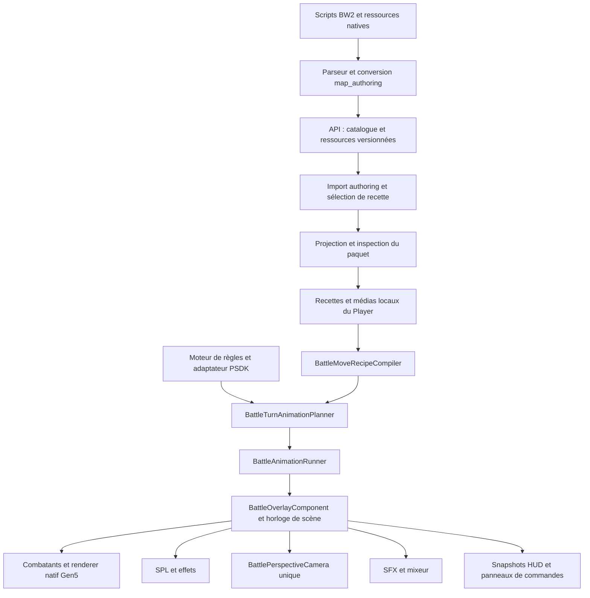

# Combat BW2 : audit et Implementation Plan

> **Pour l’exécution par un agent :** lire `skills/executing-plans/SKILL.md` avant de commencer. Si Yoahn demande une exécution déléguée, lire `skills/subagent-driven-development/SKILL.md`. Les cases ci-dessous décrivent du travail proposé, pas du travail déjà réalisé. Le présent mandat autorise l’audit et le plan uniquement ; il n’autorise ni implémentation, ni commit, ni push, ni publication.

**Goal:** faire interpréter les scripts d’animation BW2 par la présentation Avelune, avec Pokémon articulés, effets, caméra et sons synchronisés, puis convertir automatiquement le maximum d’attaques dont les instructions sont réellement prises en charge.

**Architecture:** conserver le moteur de règles, le planificateur, le runner, la caméra et les renderers existants. Ajouter un programme JSON versionné et un interprète borné raccordé à leur horloge commune ; les opérations démarrent des tâches identifiées et les attentes suivent les catégories du script source. Importer les ressources depuis l’API lors de l’édition, puis les embarquer pour jouer hors ligne.

**Tech Stack:** Dart pur pour les contrats et la conversion, Flutter/Flame pour la scène, renderer natif Gen5 existant pour les sprites par pièces, TypeScript pour le validateur de l’API, transports d’authoring directs/JSONL/MCP existants.

**Date et nature :** audit du 2 novembre 2026, suivi d’un plan d’implémentation. Aucun correctif du moteur n’est livré par ce document.

---

## 1. Conclusion accessible

Les briques de base existent, mais leur présence ne signifie pas qu’elles reproduisent ensemble les animations de Noir et Blanc. Le principal problème est la perte de sens entre le script source, le JSON converti et ce que le runtime accepte de jouer.

Le convertisseur de masse actuel fabrique surtout des approximations de placement et de chronologie. Le runtime sait afficher des particules, déplacer les Pokémon et contrôler sa caméra, mais son chemin spécial pour les recettes ne constitue pas un interprète général des scripts BW2. Enfin, le validateur local de l’API et celui de Dart ne reconnaissent pas les mêmes capacités. Ajouter davantage d’attaques maintenant augmenterait donc principalement le nombre de recettes à reprendre.

La solution proposée ne remplace pas le combat. Elle raccorde les briques existantes à une petite exécution de scripts fidèle sur un périmètre annoncé. On commence avec **Charge, Pistolet à O et Surf**, parce qu’elles couvrent déjà les attentes, les répétitions, les mouvements de Pokémon, les particules mobiles, les pauses, les couleurs, les ombres et la caméra. On prouve ces trois attaques depuis l’API jusqu’au Player hors ligne avant de généraliser.

| État | Élément | Ce que cela signifie réellement |
|---|---|---|
| 🟢 À conserver | Moteur de combat et adaptation PSDK | Les règles et les résultats d’un tour n’ont pas à être réécrits. |
| 🟢 À conserver | Caméra unique, géométrie commune, sous-pas de scène | L’autorité de projection et la base de synchronisation existent. |
| 🟢 Présent, partiel | Pokémon Gen5 par pièces | Le renderer lit les animations natives ; les commandes d’attaque et les points d’attache restent à raccorder proprement. |
| 🟠 Présent, partiel | SPL, sons et recettes | Plusieurs primitives fonctionnent ; leur couverture et leur coordination sont limitées. |
| 🔴 Reproduit | Contrat API/Dart divergent | Sur les mêmes 24 recettes : Dart en accepte 24, le validateur local TypeScript en refuse 20. |
| 🔴 Reproduit | Composition de certains groupes | Un mouvement imbriqué est ignoré ; une séquence stricte d’effets est fusionnée par le comportement historique du runner. |
| 🔴 Confirmé dans le code | Conversion de masse avec pertes | Des répétitions, trajectoires, paramètres et commandes sont retirés ou approximés. |
| ⚪ Non démontré | Fidélité globale BW2 et résultat iPhone | Les tests de logique et les aperçus actuels ne constituent pas cette preuve. |

Il serait trompeur de donner un pourcentage global de fidélité : nous n’avons pas de dénominateur qualifié. Le suivi utile est le nombre d’attaques **analysées**, **converties sans instruction perdue**, **admises par le runtime**, **comparées visuellement** et **vérifiées sur appareil**. Ces nombres doivent rester distincts.

## 2. Périmètre, état initial et limites

### 2.1 Base technique de cet audit

- Dépôt principal : `/Users/karim/Project/pokemonProject`.
- Branche : `main`.
- HEAD observé : `50d8e55c62378691dcd779e9852a9f53eaa0cf2b` — `Fix visibility of BW2 battle effects`.
- Dépôt API : `/Users/karim/Project/avelune-pokemon-api` ; aucun changement de ce dépôt dans cet audit.
- Source BW2 étudiée : [fuddlesworth/pokebw2](https://github.com/fuddlesworth/pokebw2/tree/41f42ca1afe6291f00b0ba0ec3f6099b9ff1346c), révision `41f42ca1afe6291f00b0ba0ec3f6099b9ff1346c`.
- Jeu de test existant examiné en lecture : `/Users/karim/Desktop/Pokemon_HeartGold_Test_Combats_NB2_v2.avelunegame`, 24 liaisons de recettes ; SHA-256 `9536ab1403d853d34bfd2faee37bcd0ce7d158308643abaacefe1b435e9b231a`.
- Le code lu comprend les modifications locales non commitées listées ci-dessous. Les observations ne décrivent donc pas exclusivement le HEAD publié.

### 2.2 Travail préexistant à préserver

Les neuf fichiers suivis ci-dessous étaient déjà modifiés avant l’audit. Leurs modifications ne sont pas produites par ce plan :

1. `/Users/karim/Project/pokemonProject/packages/map_authoring/lib/src/domains/gameplay/pokemon_external/gen5_batch_recipe_converter.dart`
2. `/Users/karim/Project/pokemonProject/packages/map_authoring/test/domains/gameplay/gen5_batch_recipe_converter_test.dart`
3. `/Users/karim/Project/pokemonProject/packages/map_runtime/lib/src/presentation/flame/battle_animation_runner.dart`
4. `/Users/karim/Project/pokemonProject/packages/map_runtime/lib/src/presentation/flame/battle_move_recipe_compiler.dart`
5. `/Users/karim/Project/pokemonProject/packages/map_runtime/lib/src/presentation/flame/battle_overlay_component.dart`
6. `/Users/karim/Project/pokemonProject/packages/map_runtime/test/battle_forced_replacement_timing_test.dart`
7. `/Users/karim/Project/pokemonProject/packages/map_runtime/test/battle_move_recipe_compiler_test.dart`
8. `/Users/karim/Project/pokemonProject/packages/map_runtime/test/battle_overlay_component_test.dart`
9. `/Users/karim/Project/pokemonProject/tools/pokemap_mcp/test/battle_recipe_import_stdio.test.ts`

Le dossier non suivi `/Users/karim/Project/pokemonProject/tools/avelune_attack_comparator/` est également préexistant. Il est conservé. Il contient un outil et des ressources ; sa présence n’en fait pas un résultat validé, ni un cache jetable.

Dans le dépôt API, huit fichiers de tests/outils de restauration sont non suivis : `test/backup/test_restore_qa{,_loop,_orchestrator,_protocol}.py` et `tools/restore_qa{,_loop,_orchestrator,_protocol}.py`. Ils sont hors périmètre et conservés.

### 2.3 Ce que le plan couvre

- Scène de combat solo : acteurs, caméra, effets, audio, HUD, ordre d’exécution et fin de présentation.
- Contrat source → JSON → API → import Studio → paquet → runtime hors ligne.
- Sprites Gen5 articulés, puis GIF, puis image fixe ; absence complète signalée sans planter le combat.
- Chargement, annulation, remplacement de Pokémon, erreur et retour à une pose/caméra cohérente.
- Portrait et paysage, tactile et manette via les commandes existantes, commandes détachées et chemin à deux écrans existant.
- Compatibilité avec les jeux et sauvegardes protégés depuis Studio `0.3.31+331`.
- Automatisation de la conversion, classification des manques et revue humaine efficace.

### 2.4 Exclusions explicites

- Modifier les dégâts, l’IA, les statuts, les tours, la RNG de combat ou les sauvegardes pour faire correspondre un effet.
- Refaire l’UI entière, créer une deuxième caméra, remplacer le moteur par un émulateur DS ou porter les 78 opcodes d’un coup.
- Combats triples, nouveaux modèles 3D de Pokémon, nouveau support matériel GameSir/AYN et certification de tous les modes doubles.
- Recherche de licences, refonte du stockage/API, déploiement et livraison TestFlight dans le mandat actuel.
- Réparer les quatre goldens UI rencontrés ou reprendre le comparateur pendant l’audit.

Les lots `FG-052` et `FG-053` restent ouverts : ce document ne modifie pas la roadmap et ne prononce pas leur clôture. Le rattachement produit reste le domaine Notion **Combat solo**, ticket existant **Intégrer les animations d’attaques BW2 dans Avelune** (`40b197a7bfa5817087d6e4ebf532bb8b`).

## 3. Architecture actuelle : qui décide de quoi



Le schéma décrit les responsabilités, pas une certification du raccordement. Le runtime possède notamment un chemin SPL groupé très spécialisé à côté du chemin générique de compilation.

| Responsabilité existante | Fichier et zone significative | Décision |
|---|---|---|
| Adapter le tour résolu en présentation | `/Users/karim/Project/pokemonProject/packages/map_runtime/lib/src/application/runtime_psdk_battle_session_adapter.dart` | Conserver comme frontière des règles. |
| Construire le plan visuel | `/Users/karim/Project/pokemonProject/packages/map_runtime/lib/src/presentation/flame/battle_turn_animation_planner.dart` | Conserver ; une attaque devient une exécution visuelle bornée. |
| Préparer, afficher et terminer la scène | `/Users/karim/Project/pokemonProject/packages/map_runtime/lib/src/presentation/flame/battle_overlay_component.dart` | Garder l’autorité de scène, éviter d’y ajouter une seconde VM implicite. |
| Exécuter le plan | `/Users/karim/Project/pokemonProject/packages/map_runtime/lib/src/presentation/flame/battle_animation_runner.dart` | Étendre sans changer silencieusement la sémantique historique des anciens plans. |
| Compiler les recettes | `/Users/karim/Project/pokemonProject/packages/map_runtime/lib/src/presentation/flame/battle_move_recipe_compiler.dart:58` | Distinguer acceptation des données et exécutabilité réelle. `supportsCompleteMoveVisuals` vaut actuellement `false`. |
| Avancer l’ensemble | `/Users/karim/Project/pokemonProject/packages/map_runtime/lib/src/presentation/flame/battle_overlay_component.dart:3096` | Réutiliser le sous-pas, la dette et le budget existants. |
| Projeter le monde et cadrer | `/Users/karim/Project/pokemonProject/packages/map_runtime/lib/src/presentation/flame/battle_perspective_camera.dart` et `battle_scene_layout.dart` dans le même répertoire | Caméra unique conservée ; aucune projection propre à chaque effet. |
| Importer les recettes | `/Users/karim/Project/pokemonProject/packages/map_authoring/lib/src/domains/gameplay/battle_recipe_import_actions.dart` | Utiliser l’action canonique et ses écritures ciblées. |
| Embarquer les dépendances | `/Users/karim/Project/pokemonProject/packages/map_authoring/lib/src/domains/distribution/runtime_project_projection_builder.dart:796` | Conserver la fermeture des ressources et les vérifications de hashes. |
| Inspecter les capacités du paquet | `/Users/karim/Project/pokemonProject/packages/map_distribution/lib/src/battle_recipe_bundle_inspector.dart` et `/Users/karim/Project/pokemonProject/packages/map_distribution/lib/src/avelune_runtime_compatibility.dart` | Étendre de façon additive, garder les lecteurs antérieurs. |

Les deux hôtes `/Users/karim/Project/pokemonProject/packages/map_runtime/lib/src/presentation/flame/playable_map_game.dart` et `/Users/karim/Project/pokemonProject/packages/map_runtime/lib/src/spatial/spatial_battle_runtime.dart` utilisent déjà le même overlay, mais leurs chemins de préparation/attente ne sont pas parfaitement équivalents. Un même contrat de résultat doit s’appliquer aux deux.

## 4. Constats classés par preuve et impact

**Reproduit** signifie qu’une sonde de ce tour a exercé le comportement. **Confirmé dans le code** signifie que le chemin a été lu et relié, sans reproduction complète sur appareil. **Risque** signifie qu’un scénario reste à construire ; ce n’est pas un bug utilisateur démontré.

| ID | Priorité | Constat, preuve et conséquence | Traitement |
|---|---|---|---|
| A1 | Bloquant | **Reproduit.** Les mêmes 24 recettes passent dans `BattleMoveAnimationRecipe.fromJson`, mais 20 échouent dans `inspectRecipe` local avec `Unsupported or duplicate capability`. Le service déployé n’a pas été testé par écriture. | Lot 1 : corpus commun API/Dart, puis inspection du déployé avant publication. |
| A2 | Bloquant | **Confirmé.** Le batch retire des répétitions, tronque des placements et ignore de nombreuses commandes. WaterGun passe de 17 invocations source à deux placements. | Lots 2 et 5 : préserver les instructions et instances, ne plus promettre une conversion fidèle après perte. |
| A3 | Bloquant | **Reproduit.** Un `CombatantMotionStep` dans une séquence imbriquée sous un parallèle n’est pas exécuté. Le modèle autorise le groupe, le scheduler d’accents ignore ce type. | Lot 3 : admission explicite et interprétation du nouveau programme ; caractériser l’ancien chemin. |
| A4 | Bloquant | **Reproduit.** Une séquence stricte de deux accents démarre ses deux effets ensemble après normalisation/fusion. Ce comportement est historique : le changer globalement casserait potentiellement d’anciens plans. | Lot 3 : nouvelle sémantique explicite, anciens plans conservés et testés. |
| A5 | Haute | **Confirmé.** Les noms `McssSetVanish` et `McssSetValue` peuvent conduire à un mauvais mapping : pause/freeze d’un côté, ombre de l’autre. | Lots 2 et 4 : traduire les effets réels de la source, pas les noms. |
| A6 | Haute | **Confirmé.** Le chemin SPL avec mouvement peut attendre la fin du clip audio pour terminer les visuels, contrairement à `Wait ALL` dans BW2. | Lots 3 et 7 : tâches et barrières visuelles/audio distinctes. |
| A7 | Haute | **Confirmé.** `userMouth` et `targetImpact` correspondent actuellement au centre du rectangle ; leur géométrie n’applique pas toute la transformation de script. | Lot 4 : points d’attache déclarés, espace explicite et cohérence avec l’image affichée. |
| A8 | Haute | **Confirmé.** L’enveloppe de cadrage ne prend pas en compte les mouvements Gen5 ; certaines correspondances pixel/Z sont empiriques. | Lot 6 : une conversion de coordonnées nommée, enveloppes et presets vérifiés. |
| A9 | Haute | **Risque structurel.** L’échange de Pokémon est instantané côté runner mais la synchronisation du sprite est asynchrone et non attendue. L’animation d’envoi peut précéder le bon sprite. | Lots 3 et 4 : préparation et publication d’identité atomiques ; test de chargement volontairement retardé. |
| A10 | Haute | **Risque structurel.** Une erreur de préparation peut laisser un plan actif ; les deux hôtes ne règlent pas leur attente de la même manière. | Lot 3 : terminaison explicite succès/repli/échec/annulation. |
| A11 | Moyenne | **Confirmé.** Le chemin SPL groupé actuel est admis en solo à vitesse 1, intensité 1, sans réduction d’effets. | Lots 1, 8 et 10 : politique annoncée par profil ; aucun support implicite pour les autres modes. |
| A12 | Moyenne | **Confirmé.** Une priorité Canvas SPL élevée ne garantit pas une occlusion correcte par les Pokémon, même avec des coordonnées en profondeur. | Lot 5 : couches avant/arrière et contrôle visuel. |
| A13 | Moyenne | **Confirmé dans le code.** La création d’une voix SFX calcule son volume depuis le mix brut plutôt que depuis le mixeur tenant compte du ducking. | Lot 7 : test d’une voix créée pendant le ducking. |
| A14 | À mesurer | Le renderer natif relit la géométrie et republie une image RGBA ; aucune mesure de cet audit ne permet d’en faire le goulot d’étranglement principal. | Lot 10 : profiler froid/chaud ; optimiser seulement le coût mesuré. |

### 4.1 Où se perd le script

- `/Users/karim/Project/pokemonProject/packages/map_authoring/lib/src/domains/gameplay/pokemon_external/gen5_battle_script_source.dart:46` traite une structure limitée à un en-tête/variante/label et un `End` terminal.
- `/Users/karim/Project/pokemonProject/packages/map_authoring/lib/src/domains/gameplay/pokemon_external/gen5_batch_script_selection.dart:49` choisit la première variante visible et retire des labels internes en s’arrêtant au premier `End`.
- `/Users/karim/Project/pokemonProject/packages/map_authoring/lib/src/domains/gameplay/pokemon_external/gen5_battle_script_commands.dart` contient les tables d’une vingtaine de commandes, sans la totalité des unités et effets source.
- `/Users/karim/Project/pokemonProject/packages/map_authoring/lib/src/domains/gameplay/pokemon_external/gen5_battle_script_control_flow.dart:35` distingue déjà plusieurs attentes, mais cette analyse n’est pas la sémantique effectivement exécutée par le batch.
- `/Users/karim/Project/pokemonProject/packages/map_authoring/lib/src/domains/gameplay/pokemon_external/gen5_battle_source_dependencies.dart:198` ne représente pas encore toute la fermeture de plusieurs ressources chargées.
- `/Users/karim/Project/pokemonProject/packages/map_authoring/lib/src/domains/gameplay/pokemon_external/gen5_batch_recipe_converter.dart` additionne surtout `WaitFrames`, retire le premier retard d’émetteur, déduplique des instances et limite les placements. Les warnings ne remplacent pas les commandes retirées.
- `/Users/karim/Project/pokemonProject/packages/map_authoring/lib/src/domains/gameplay/pokemon_external/gen5_batch_particle_approximation.dart:36` retire ou remplace notamment géométrie, rotations, comportements, variance, répétitions, durées et enfants.

Le convertisseur pilote de Charge comporte des profils particuliers. Ses primitives réutilisables sont utiles ; multiplier les profils indexés par attaque/hash ne constitue pas la stratégie de généralisation.

### 4.2 Pourquoi les tests actuels ne détectent pas tout

Un parseur peut accepter un JSON dont le compilateur ne sait pas jouer toutes les opérations. Un test d’admission peut réussir alors que les paramètres de temps ont été neutralisés. Par exemple, `/Users/karim/Project/pokemonProject/packages/map_runtime/test/gen5_batch_runtime_qualification_test.dart:67` remplace les `startTick` par zéro : il ne valide pas la chronologie source.

Le test synthétique de Surf valide une sortie du convertisseur, pas l’exécution du script original. Le test du son confirme un chemin audio, pas la présence ni la fidélité de l’image. La prochaine preuve doit comparer les événements du script, leurs ticks, leurs paramètres et des captures de la scène réelle.

## 5. Sémantique BW2 à préserver

Ces points ont été recoupés dans la révision BW2 épinglée. Ils doivent devenir des fixtures/test vectors avant de coder leur adaptation.

| Instruction/contrat source | Signification vérifiée | Conséquence Avelune |
|---|---|---|
| `McssSetVanish` | Appelle `BtlvMcss_SetAnimPause` : modes 1 pause, 2 freeze, 3 unfreeze, autres resume. | Ne pas traduire par une disparition du Pokémon. Garder les modes distincts tant que leur équivalence n’est pas prouvée. |
| `McssSetValue` | Appelle `MCSS_SetNoShadow` par le chemin MCSS. | Pilote l’ombre, pas la pause d’animation. |
| `McssSetMode` | Peut réellement déclencher un vanish. | Ne pas confondre avec `McssSetVanish`. Hors premier sous-ensemble s’il n’est pas requis par les pilotes. |
| `Wait ALL` | Attend les tâches visuelles, caméra, MCSS, particules, fades ; exclut les sons. | Une voix longue ne doit pas bloquer seule les visuels. |
| `Wait SE` | Attend les sons et automatisations sonores concernés. | Une barrière audio dédiée est nécessaire. |
| `SetYield FALSE/TRUE` | Autorise plusieurs instructions dans le même appel source ou rend la main. | Conserver une notion d’appel/tick source, pas seulement des timestamps cumulés. |
| Callback d’attente terminé | Rend la main sans exécuter immédiatement l’instruction suivante. | Reprise au prochain appel source ; prévoir `nextEligibleTick`. |
| `WaitFrames 2` émis à l’appel 0 | Callback aux appels 1 et 2 ; instruction suivante à l’appel 3. | Une simple addition de deux frames n’est pas équivalente. |
| `WaitFrames 0` | Callback à l’appel 1 ; instruction suivante à l’appel 2. | Zéro ne signifie pas absence de yield. |
| `ParticleLoad` | Termine toujours l’appel courant, conserve le flag yield existant ; le premier chargement implique aussi des étapes natives d’upload/VBlank. | Précharger physiquement ne doit pas effacer la frontière logique source. Après un callback de chargement terminé, la reprise attend encore l’appel suivant. La latence native exacte reste à qualifier par trace. |
| `Wait` et `WaitFrames` | Remettent le flag yield à `TRUE`, contrairement à `ParticleLoad`. | Tester ce changement d’état, y compris après `SetYield FALSE`. |
| `EmitterAdd` et `EmitterMove` | Créent chacun une nouvelle instance. `EmitterMove` crée un émetteur avec callback puis initialise sa trajectoire. | Ne pas traduire `EmitterMove` comme une modification d’un émetteur préexistant. |
| `EmitterMove.motionFrames` | Valeur fx32 ; `0x1e000 >> 12` donne 30 frames. | Conserver la valeur brute et convertir l’unité une seule fois. |
| `EmitterMove`, mouvement type 1 | Progression sinusoïdale sur un demi-tour, hauteur forcée à zéro. | Une interpolation linéaire de projectile n’est pas une traduction fidèle. |
| Ordre d’un tick BW2 | VM, gestionnaire de tâches, puis MCSS/caméra. | Ajouter une phase de programme source à l’horloge existante. Ne pas corriger avec des délais empiriques en millisecondes. |

Sources précises : [VM](https://github.com/fuddlesworth/pokebw2/blob/41f42ca1afe6291f00b0ba0ec3f6099b9ff1346c/src/system/vm.c#L49), [création par EmitterMove](https://github.com/fuddlesworth/pokebw2/blob/41f42ca1afe6291f00b0ba0ec3f6099b9ff1346c/src/ov168/btlv_effvm.c#L1349), [effvm pause](https://github.com/fuddlesworth/pokebw2/blob/41f42ca1afe6291f00b0ba0ec3f6099b9ff1346c/src/ov168/btlv_effvm.c#L1718), [MCSS](https://github.com/fuddlesworth/pokebw2/blob/41f42ca1afe6291f00b0ba0ec3f6099b9ff1346c/src/ov168/btlv_mcss.c#L597), [ordre de mise à jour](https://github.com/fuddlesworth/pokebw2/blob/41f42ca1afe6291f00b0ba0ec3f6099b9ff1346c/src/ov168/btlv_effect.c#L370), [déclarations d’instructions](https://github.com/fuddlesworth/pokebw2/blob/41f42ca1afe6291f00b0ba0ec3f6099b9ff1346c/include/asm/btlv_effvm.inc#L113).

### 5.1 Premier sous-ensemble réellement utile

Les corps linéaires des trois scripts [tackle.s](https://github.com/fuddlesworth/pokebw2/blob/41f42ca1afe6291f00b0ba0ec3f6099b9ff1346c/res/battle/animations/moves/tackle.s), [water_gun.s](https://github.com/fuddlesworth/pokebw2/blob/41f42ca1afe6291f00b0ba0ec3f6099b9ff1346c/res/battle/animations/moves/water_gun.s) et [surf.s](https://github.com/fuddlesworth/pokebw2/blob/41f42ca1afe6291f00b0ba0ec3f6099b9ff1346c/res/battle/animations/moves/surf.s) utilisent 17 commandes :

`CameraMovePreset`, `CameraShake`, `ParticleLoad`, `EmitterAdd`, `EmitterMove`, `McssMoveXY`, `McssScale`, `McssSetVanish`, `McssPalFade`, `McssSetValue`, `PlaySE`, `PanSE`, `MoveSE`, `Wait`, `WaitFrames`, `SetYield`, `End`.

La présence de ces 17 noms ne suffit pas : l’admission doit vérifier les modes, unités, ressources et contextes qu’ils utilisent. Les scripts de début/fin source peuvent invoquer des comportements externes, notamment liés au clone/Substitute. Le premier périmètre exact exclut ces contextes tant qu’ils ne sont pas portés. Ils doivent déclencher un repli déclaré, pas être ignorés.

Pistolet à O requiert **15 jets mobiles et 2 impacts**, soit 17 invocations ; les mêmes données d’émetteur peuvent donc produire plusieurs instances distinctes. Surf requiert cinq invocations `222/{3,1,4,5,2}`, avec une échelle par invocation `0xb33` proche de 0,7, des commandes de caméra et de MCSS. Une représentation « quelques particules démarrent à zéro » ne conserve pas cette animation.

## 6. Contrat cible proposé et invariants communs

### 6.1 Versionner sans casser les jeux existants

Proposition du lot 1 : conserver les lecteurs et la sémantique des recettes v1/v2 ; ajouter une recette v3 contenant un programme de présentation typé. `schemaVersion: 3`, version de définition SPL et version du paquet sont trois dimensions distinctes. La nouvelle capacité proposée est `gen5ProgramV1` ; ce nom n’existe pas encore et doit être ajouté conjointement dans Core, API, compilateur et compatibilité de distribution.

Le modèle proposé se nomme `BattleMovePresentationProgram`. Le lecteur de `/Users/karim/Project/pokemonProject/packages/map_core/lib/src/models/battle_move_animation_recipe.dart` reste l’entrée de validation. Les opérations ne sont jamais évaluées depuis des chaînes de code et ne donnent aucun accès fichier/réseau à l’interprète.

| Groupe de données | Champs/sens à fixer dans le lot 1 | Règle |
|---|---|---|
| Identité | Identité de recette, attaque, révision et variante | Une révision publiée reste immuable. |
| Provenance | Révision source, chemin, hash, variante/label, version du convertisseur | Reproduction sans dépendre d’une branche Git mouvante. |
| Programme | `timebaseHz`, instructions ordonnées, instruction source et index | Première version : 60 Hz logique, sous-ensemble linéaire explicite. |
| Instructions | Opération typée et arguments normalisés ; opérandes bruts dans la provenance | Pas de payload arbitraire admis puis silencieusement ignoré. |
| Ressources | ID local, rôle, taille, SHA-256, dépendances et version de définition | Vérification avant exécution, fermeture intégrale à l’export. |
| Contextes | Variantes et contextes supportés, conditions d’admission | Aucun choix automatique de la première variante inconnue. |
| Qualité de conversion | `supported`, `approximate`, `unsupported` et raisons structurées | Décrit la couverture des instructions, pas l’approbation visuelle. |
| Preuves séparées | Admission runtime, comparaison source, validation appareil | Une preuve peut manquer même si les données sont valides. |

Ne pas créer une infrastructure de génération de schémas pour ce seul besoin. Le corpus JSON de cas positifs/négatifs, consommé par les tests Dart et TypeScript avec un hash identique, suffit à empêcher la divergence immédiate. L’API conserve ses propres limites de taille, profondeur, ressources et travail ; les élargissements sont motivés par le corpus, jamais par la suppression des garde-fous.

### 6.2 Programme, tâches et attentes

L’interprète proposé `BattleMoveProgramPlayback` est un objet de lecture de présentation, rattaché au runner et à la scène. Ce n’est pas une nouvelle boucle de jeu. Il possède seulement son compteur d’instruction, le tick éligible suivant, ses tâches et son état terminal.

Les noms ci-dessous sont proposés ; le lot 1 doit les figer et les tests doivent employer exactement les mêmes noms :

```text
loadParticle       -> frontière logique de chargement
startEmitter       -> nouvelle instance fixe, handle propre
startMovingEmitter -> nouvelle instance avec trajectoire, handle propre
moveCombatant      -> transformation locale d’un acteur
scaleCombatant     -> échelle locale de script
setAnimationState  -> pause/freeze/unfreeze/resume source
setShadow          -> état de l’ombre
fadePalette        -> tâche de couleur sur l’acteur
moveCameraPreset   -> tâche de la caméra existante
shakeCamera        -> contribution à cette même caméra
playSound          -> voix identifiée
panSound           -> automatisation audio
moveSound          -> automatisation audio source
waitTasks          -> catégories source explicites
waitFrames         -> attente logique avec callback/reprise
setYield           -> politique d’un appel source
end                -> sortie du programme et politique de fin validée
```

Chaque `EmitterAdd` est traduit en `startEmitter`, chaque `EmitterMove` en `startMovingEmitter`. Chaque invocation crée une nouvelle instance même si l’ID de définition est identique. L’instance mobile possède sa trajectoire et son propre handle ; aucun jet ne se rattache implicitement à l’instance précédente. Une éventuelle primitive interne de déplacement d’instance existante est distincte et n’est pas le sens de l’opcode source `EmitterMove`.

Catégories minimales de tâches : particules, acteur/MCSS, caméra, palette et audio. Les masques `ALL`/`SE` sont définis par les tables source, pas par une vague notion de « tout ce qui joue ». Les callbacks d’attente terminés ne peuvent pas relancer le programme durant le même appel source.

Schéma d’intégration, à transformer en tests avant le code :

```text
pour chaque tick logique dû, sous le budget de scène existant :
  reprendre le programme si tick >= nextEligibleTick
  démarrer les tâches jusqu’à une instruction qui rend la main
  avancer les tâches visuelles et leurs compteurs selon l’ordre source
  avancer MCSS/caméra dans leur phase source
  publier l’état cohérent de la scène et la demande de frame Gen5
  observer la fin des tâches sans réentrer dans le programme
  conserver la dette non traitée pour le prochain update
```

Chaque tâche possède un seul pilote d’avancement. Le programme commande les composants existants sans les avancer une seconde fois ; la caméra déjà avancée par l’overlay ne reçoit pas un second update du playback. Le tick source entier est indépendant des sous-pas fractionnés de scène : une phase VM/tâches/MCSS-caméra s’exécute exactement une fois par tick logique dû. Une frontière de phase du runner ne peut ni doubler ni supprimer ce tick.

L’audio natif reste asynchrone : la trace de commande ne prouve pas son heure audible. Les tests logiques utilisent une horloge et des voix contrôlées ; un contrôle d’enregistrement valide ensuite l’écart perceptible.

### 6.3 Géométrie, acteurs et points d’attache

- Garder la projection de `BattlePerspectiveCamera` comme seule conversion monde → écran.
- Distinguer coordonnées source DS/fx32, coordonnées locales de l’acteur, monde de combat, pixels du viewport et zone HUD.
- La caméra ne doit pas déplacer le HUD ; un resize ne doit pas réinterpréter les unités d’une attaque.
- Définir une conversion source → monde unique et testée. Les facteurs actuels `offsetX / 12`, échelle → Z et `anchor.unit * 5` ne sont pas des preuves de cette équivalence.
- Un point d’attache est nommé avec son espace et son mode : suit l’acteur, suit une pièce disponible, ou est figé au déclenchement. Un centre de rectangle peut rester un repli, mais ne s’appelle pas une bouche mesurée.
- Publier ensemble identité/révision d’acteur, image affichée, tick effectivement rendu, points d’attache et bornes. Les points ne doivent pas provenir d’une frame future pendant que l’ancienne image est encore affichée.
- Séparer les bornes stables de cadrage et les bornes visibles animées. Préserver la stabilité sans perdre les débordements d’un mouvement d’attaque.

Le renderer Gen5 possède déjà les données de pièces NCER/NANR/NMCR/NMAR. Il n’est pas nécessaire d’inventer une animation d’articulation par attaque. Les commandes MCSS peuvent agir sur tout le Pokémon ou son état d’animation ; un contrôle arbitraire de chaque articulation n’est ajouté que si une instruction source réellement rencontrée l’exige. AnimaEngine n’est donc pas un préalable démontré à ce plan.

### 6.4 Cycle de vie et résultat

```text
prepared -> started -> playbackFinished -> released
prepared/started -> failed -> released
prepared/started -> cancelled -> released
```

Une génération d’overlay et une identité de présentation accompagnent les callbacks asynchrones. Un résultat périmé ne peut pas remplacer le Pokémon courant. `playbackFinished` autorise la progression de présentation selon le contrat ; `released` signifie que les ressources et voix possédées sont libérées. Ce sont deux preuves distinctes.

Pour chaque sortie : restaurer les transformations temporaires, les pauses, la palette, les ombres et la caméra dont l’exécution est propriétaire. Ne pas écraser un réglage permanent ni une transformation détenue par un autre propriétaire. Une préparation en échec ne doit pas laisser un Future attendu indéfiniment par un des hôtes.

La RNG visuelle est déterministe pour la recette mais indépendante de la RNG des règles. Aucun `await` audio ou décodage ne doit changer le résultat d’un tour.

### 6.5 Replis annoncés

| Situation | Comportement proposé |
|---|---|
| Programme et ressources admis | Jouer la recette sélectionnée et tracer son identité/révision. |
| Instruction, mode ou contexte absent | Repli de présentation existant avant tout démarrage partiel ; raison structurée pour l’auteur. |
| Ressource corrompue/incomplète | Échec de préparation clair ; aucune lecture arbitraire ; repli sûr si la présentation est optionnelle selon le contrat du jeu. |
| Sprite articulé absent | GIF ; si absent, image fixe ; si tout manque, état explicite sans blocage de tour. |
| Audio exact absent | Déclarer `audioApproximate` et utiliser la politique retenue ; ne pas présenter un MP3 d’attaque complète comme les SE natifs. |
| Profil réduit/vitesse/double non qualifié | Politique de repli explicite et testée ; ne pas exécuter « à moitié » en silence. |
| Format futur réellement inconnu | Erreur de compatibilité claire ; préserver jeu et sauvegarde, sans réinitialisation. |

## 7. Plan d’exécution détaillé en dix lots

Les noms de fichiers marqués **à créer** sont des propositions d’implémentation. Les autres existent au moment de l’audit. Chaque lot commence par un test négatif ciblé, conserve une preuve du comportement avant correction et finit par ses tests, son analyse ciblée et une mise à jour du ticket existant. Aucun commit/rebase/push n’est implicite : demander une autorisation seulement si Yoahn souhaite cette livraison Git lors de l’exécution.

Ordre recommandé : **1 → 2 → 3 → 4 → 5 → 6 → 7 → 8 → 9 → 10**. Une scène intégrée minimale avec vrai sprite et programme v3 est nécessaire dès le lot 3 ; les lots 4 à 7 complètent les adaptateurs nécessaires aux trois attaques. Le lot 8 est la barrière des trois pilotes, pas le premier moment où l’on regarde une image. La scène minimale n’est pas présentée comme Charge tant que toutes les instructions de Charge ne sont pas raccordées.

### Lot 1 — Unifier le contrat Core, API, import et paquet

**Résultat attendu :** un même corpus reçoit le même verdict et les mêmes raisons dans les validateurs ; une recette acceptée n’est pas confondue avec une recette jouable.

**Fichiers concernés :**

- Modifier `/Users/karim/Project/pokemonProject/packages/map_core/lib/src/models/battle_move_animation_recipe.dart` ; ajouter la lecture v3 sans changer les valeurs par défaut v1/v2.
- Créer `/Users/karim/Project/pokemonProject/packages/map_core/lib/src/models/battle_move_presentation_program.dart` pour les instructions typées, catégories, unités et diagnostics ; exporter via `/Users/karim/Project/pokemonProject/packages/map_core/lib/map_core.dart`.
- Modifier `/Users/karim/Project/avelune-pokemon-api/src/animations/inspect-recipe.ts` et ses validateurs SPL appelés, ainsi que `/Users/karim/Project/avelune-pokemon-api/test/animations/recipe-contract-vectors.json`.
- Modifier `/Users/karim/Project/pokemonProject/packages/map_distribution/lib/src/battle_recipe_bundle_inspector.dart` et `/Users/karim/Project/pokemonProject/packages/map_distribution/lib/src/avelune_runtime_compatibility.dart`.
- Examiner les points d’import/projection existants : `/Users/karim/Project/pokemonProject/packages/map_authoring/lib/src/domains/gameplay/battle_recipe_import_actions.dart` et `/Users/karim/Project/pokemonProject/packages/map_authoring/lib/src/domains/distribution/runtime_project_projection_builder.dart`.
- Tests : `/Users/karim/Project/pokemonProject/packages/map_core/test/battle_move_animation_recipe_test.dart`, `/Users/karim/Project/pokemonProject/packages/map_distribution/test/battle_recipe_bundle_inspector_test.dart`, `/Users/karim/Project/pokemonProject/packages/map_distribution/test/avelune_runtime_compatibility_test.dart`, `/Users/karim/Project/avelune-pokemon-api/test/animations/inspect-recipe.test.ts` et `inspect-spl-v2.test.ts` dans le même répertoire.

- [ ] **1.1 Figer le corpus avant de changer le validateur.** Prendre les 24 recettes observées, les anciennes fixtures v1/v2 et les cas invalides : capacité inconnue/dupliquée, version SPL sans capacité, ressource absente, mauvais hash, programme sans fin, référence d’instance invalide et dépassement des limites. Conserver uniquement les petits vecteurs nécessaires, pas une copie du paquet de jeu complet.
- [ ] **1.2 Écrire le test différentiel.** Les tests produisent pour chaque ID `{accepted, reasonCode}` ; le corpus possède un hash identique dans les deux dépôts. Le résultat attendu initial est la divergence 24/24 contre 4/24 ; le résultat visé est une divergence nulle, y compris sur les rejets.
- [ ] **1.3 Figer v3.** Définir les 17 opérations normalisées de la section 6, leurs types, contextes admis, valeurs finies, références et bornes. Un champ source ne devient pas automatiquement une capacité runtime. Refuser toute opération dont les arguments ne sont pas connus.
- [ ] **1.4 Étendre de façon additive.** Accepter SPL3/4 et leurs capacités conjointement là où le runtime sait déjà les lire ; ajouter la nouvelle capacité du programme. Une version nouvelle n’assouplit pas les limites de sécurité des anciennes.
- [ ] **1.5 Prouver import et export.** Une recette v3 importée par l’action canonique conserve bytes/hashes et révision ; le paquet inclut la fermeture des ressources. Une dépendance manquante doit empêcher une exportation trompeuse. L’API ne devient jamais nécessaire pendant le combat.
- [ ] **1.6 Prouver la compatibilité.** Relire les fixtures v1/v2 sans migration destructive ; une capacité inconnue donne un diagnostic stable. Distinguer les fixtures actuelles et les véritables exports protégés de la baseline.

Commandes à exécuter depuis chaque package/racine indiqué :

```bash
cd /Users/karim/Project/pokemonProject/packages/map_core
dart test test/battle_move_animation_recipe_test.dart
dart analyze lib/src/models/battle_move_animation_recipe.dart lib/src/models/battle_move_presentation_program.dart
cd /Users/karim/Project/avelune-pokemon-api
node --import tsx --test test/animations/inspect-recipe.test.ts test/animations/inspect-spl-v2.test.ts test/animations/inspect-recipe-bundle.test.ts test/animations/recipe-upload-bounds.test.ts
npm run typecheck
cd /Users/karim/Project/pokemonProject/packages/map_distribution
dart test test/battle_recipe_bundle_inspector_test.dart test/avelune_runtime_compatibility_test.dart test/game_package_compatibility_test.dart
dart analyze
```

**Sortie :** corpus commun sans divergence et anciens lecteurs vérifiés. **Arrêt :** ne pas publier une v3 si un validateur l’accepte en perdant une instruction ou si les anciennes fixtures changent de sens. L’écart avec le service déployé doit être vérifié séparément avant une activation future.

### Lot 2 — Préserver la source et inventorier automatiquement la couverture

**Dépendance :** contrat du lot 1 figé. **Résultat attendu :** aucun label, variante, invocation ou opérande ne disparaît sans diagnostic bloquant ; un inventaire indique quelles attaques peuvent être converties par le sous-ensemble implémenté.

**Fichiers concernés :**

- Modifier `/Users/karim/Project/pokemonProject/packages/map_authoring/lib/src/domains/gameplay/pokemon_external/gen5_battle_script_source.dart`.
- Modifier `/Users/karim/Project/pokemonProject/packages/map_authoring/lib/src/domains/gameplay/pokemon_external/gen5_batch_script_selection.dart`, `gen5_battle_script_commands.dart`, `gen5_battle_script_parameters.dart`, `gen5_battle_script_symbols.dart`, `gen5_battle_script_control_flow.dart` et `gen5_battle_source_dependencies.dart` dans ce même répertoire.
- Modifier `/Users/karim/Project/pokemonProject/packages/map_authoring/lib/src/domains/gameplay/pokemon_external/gen5_batch_recipe_converter.dart` et `/Users/karim/Project/pokemonProject/packages/map_authoring/tool/gen5_batch_convert.dart`.
- Créer `/Users/karim/Project/pokemonProject/packages/map_authoring/test/domains/gameplay/gen5_source_program_converter_test.dart` ; étendre les tests source/paramètres/control-flow/batch existants.

- [ ] **2.1 Capturer les trois scripts intégraux épinglés.** Conserver leurs variantes, labels, opérandes signés/non signés et indices source. Ne pas retirer des branches au prétexte qu’elles ne sont pas encore exécutables.
- [ ] **2.2 Séparer analyse et sélection.** L’analyse conserve toutes les variantes. La sélection reçoit un contexte explicite ; une variante ambiguë n’est pas la première variante par défaut.
- [ ] **2.3 Formaliser unités, commandes et symboles.** Pour chaque commande pilote, enregistrer arité, mode, unité fx32/frame/coordonnée et effet attendu. `0x1e000` devient 30 frames dans le champ concerné ; ne pas appliquer ce décalage à tous les nombres hexadécimaux. Étendre le résolveur pour les constantes nécessaires, dont `EFFVM_ALL`, et son test `gen5_battle_script_symbols_test.dart`. Distinguer constante de ciblage résolue, symbole SE référencé et média SE absent : une ressource sonore manquante n’est pas une instruction inconnue.
- [ ] **2.4 Préserver les invocations.** Les 17 invocations de WaterGun et les cinq de Surf restent identifiables, avec leurs paramètres propres. Aucun maximum de cinq placements ni déduplication par tuple de définition n’est appliqué au programme exact.
- [ ] **2.5 Résoudre les dépendances.** Parcourir tous les chargements et références de ressources/sons ; distinguer une donnée absente d’une instruction inconnue. La fermeture est déterministe et ne s’appuie pas sur une seule valeur `particleId`.
- [ ] **2.6 Scanner le corpus complet sans conversion en production.** Produire un JSON/CSV agrégé : attaque, variante, nombre d’instructions, opcodes/modes inconnus, ressources absentes, présence de branche/call, raison d’exclusion et version du convertisseur.
- [ ] **2.7 Émettre v3 pour les pilotes linéaires seulement.** Garder le batch historique sous le statut approximation ; ne pas faire disparaître ses warnings en renommant sa sortie. Ajouter une famille d’opcodes seulement quand l’inventaire montre le gain attendu et que ses tests source existent.

Exemples d’assertions concrètes, à adapter aux accesseurs du modèle figé au lot 1 :

```text
WaterGun : instructions source conservées = instructions analysées
WaterGun : invocations émetteurs = 17, dont EmitterMove = 15 et EmitterAdd = 2
Surf : instances émetteurs = [3, 1, 4, 5, 2], resourceId = 222
EmitterMove motionFrames 0x1e000 : durée normalisée = 30 frames
commande/mode inconnu : quality = unsupported, diagnostic avec index source
deux variantes non résolues : sélection refusée, aucune variante retirée
```

Commandes :

```bash
cd /Users/karim/Project/pokemonProject/packages/map_authoring
dart test test/domains/gameplay/gen5_battle_script_source_test.dart test/domains/gameplay/gen5_battle_script_parameters_test.dart test/domains/gameplay/gen5_battle_script_symbols_test.dart test/domains/gameplay/gen5_battle_script_control_flow_test.dart test/domains/gameplay/gen5_batch_recipe_converter_test.dart test/domains/gameplay/gen5_source_program_converter_test.dart
dart analyze lib/src/domains/gameplay/pokemon_external tool/gen5_batch_convert.dart
```

**Sortie :** inventaire complet avec totaux par cause, et trois programmes sans perte d’instruction admise. **Arrêt :** une commande sans sémantique prouvée reste exclue ; aucune estimation inventée du nombre final d’attaques supportées.

### Lot 3 — Interpréter sur la même horloge, régler les attentes et les erreurs

**Dépendances :** lots 1 et 2. **Résultat attendu :** mêmes événements logiques sous plusieurs découpages de `dt`, attentes source respectées et aucune fin de tour suspendue indéfiniment.

**Fichiers concernés :**

- Créer `/Users/karim/Project/pokemonProject/packages/map_runtime/lib/src/presentation/flame/battle_move_program_playback.dart` et `/Users/karim/Project/pokemonProject/packages/map_runtime/test/battle_move_program_playback_test.dart`.
- Modifier `/Users/karim/Project/pokemonProject/packages/map_runtime/lib/src/presentation/flame/battle_animation_runner.dart`, `battle_animation_plan.dart`, `battle_move_recipe_compiler.dart` et `battle_overlay_component.dart` dans ce même répertoire.
- Harmoniser les appels dans `/Users/karim/Project/pokemonProject/packages/map_runtime/lib/src/presentation/flame/playable_map_game.dart` et `/Users/karim/Project/pokemonProject/packages/map_runtime/lib/src/spatial/spatial_battle_runtime.dart`, sans modifier leurs règles de combat.
- Tests existants à étendre : `/Users/karim/Project/pokemonProject/packages/map_runtime/test/battle_animation_runner_test.dart`, `battle_animation_runner_budget_test.dart`, `battle_scene_clock_test.dart`, `battle_offline_move_recipe_loader_test.dart` et `spatial_battle_runtime_test.dart` dans ce même répertoire de tests.

- [ ] **3.1 Pérenniser les deux sondes rouges de l’audit.** Conserver une caractérisation des anciens plans et une attente stricte pour v3. Un groupe inconnu doit être refusé, jamais accepté puis sauté par le `default` du scheduler.
- [ ] **3.2 Introduire l’objet de playback minimal.** Compteur d’instruction, `nextEligibleTick`, table des tâches possédées, budget et résultat terminal. Aucune `Timer`, boucle parallèle ou dépendance des règles vers Flutter.
- [ ] **3.3 Ajouter la phase source au sous-pas existant.** Conserver l’application unique de la vitesse, la dette non traitée, les limites de sous-pas et le budget de travail. Vérifier les phases VM → tâches → MCSS/caméra ; ne pas conserver l’ordre actuel par accident pour v3. Un composant ou la caméra ne peut pas être avancé à la fois par son chemin existant et le playback ; compter ses avancements dans les tests, y compris aux frontières de phases du runner.
- [ ] **3.4 Exécuter démarrages et attentes.** Démarrer une tâche est non bloquant. `Wait ALL` exclut audio ; `Wait SE` inclut les automatismes audio source. `WaitFrames 0/2`, yield et callback terminé reprennent au bon appel.
- [ ] **3.5 Séparer chargement physique et logique.** Préparer les bytes avant le tour, mais conserver l’instruction `loadParticle`, sa fin d’appel et la valeur antérieure du flag yield. `Wait`/`WaitFrames` remettent ce flag à vrai. Tester `SetYield FALSE → ParticleLoad → deux starts`, ressource déjà chargée puis nouvelle ressource avec callback contrôlé ; vérifier l’appel supplémentaire après résolution du callback. Tant que la latence native de premier chargement n’est pas qualifiée, la marquer dans la preuve temporelle ; ne pas l’aligner sur le temps de décodage Flutter.
- [ ] **3.6 Unifier la terminaison.** La méthode commune de préparation/lecture de l’overlay règle exactement une fois le résultat succès/repli/échec/annulation. Les deux hôtes attendent ce résultat selon le même contrat. Annuler invalide les callbacks de génération et clôt les tâches possédées.
- [ ] **3.7 Faire une première preuve visible intégrée.** Utiliser le vrai overlay, un vrai sprite Gen5 et un programme v3 minimal exécutant seulement des opérations déjà raccordées. Montrer sa trace de ticks, un effet visible et sa terminaison réelle ; toute instruction non raccordée reste refusée. Ce n’est pas encore une preuve de Charge. Dès que les adaptateurs nécessaires sont disponibles dans les lots 4 à 7, remplacer cette sonde par la vraie Charge convertie ; aucun stub ni chemin legacy ne satisfait cette preuve.

Table de tests de l’interprète :

| Cas | Attente précise |
|---|---|
| `waitFrames(2)` émis au tick 0 | Instruction suivante au tick 3. |
| `waitFrames(0)` émis au tick 0 | Instruction suivante au tick 2. |
| Tâche visuelle 3 ticks, audio 20 ticks, `waitTasks(ALL)` | La voix seule ne prolonge pas la barrière visuelle. |
| Même scène avec `waitTasks(SE)` | La barrière attend la voix et ses automatismes. |
| Découpages 1/120, 1/60, 1/30 et coupure à une frontière de phase | Même trace et même nombre d’avancements des tâches/caméra après les mêmes ticks traités. |
| Gros `dt` dépassant le budget | Travail borné, dette conservée, aucune instruction perdue. |
| Préparation rejetée | Les deux hôtes obtiennent un résultat terminal ; aucune attente pendante. |
| Annulation puis nouvelle attaque | Aucun callback/effet de l’ancienne génération dans la nouvelle. |

Commandes :

```bash
cd /Users/karim/Project/pokemonProject/packages/map_runtime
flutter test --no-pub --concurrency=1 test/battle_move_program_playback_test.dart test/battle_animation_runner_test.dart test/battle_animation_runner_budget_test.dart test/battle_scene_clock_test.dart test/battle_offline_move_recipe_loader_test.dart test/spatial_battle_runtime_test.dart
flutter analyze lib/src/presentation/flame/battle_move_program_playback.dart lib/src/presentation/flame/battle_animation_runner.dart lib/src/presentation/flame/battle_overlay_component.dart lib/src/spatial/spatial_battle_runtime.dart
```

**Sortie :** traces source déterministes et scène v3 minimale visible avec terminaison propre ; Charge complète reste à prouver après raccordement de ses handlers. **Arrêt :** si l’ordre exige de changer silencieusement les anciens plans, garder un chemin versionné et caractériser ces plans avant de poursuivre.

### Lot 4 — Raccorder les Pokémon articulés et sécuriser les remplacements

**Dépendance :** lot 3. **Résultat attendu :** le bon Pokémon est visible au bon moment, ses transformations et points d’attache correspondent à la frame affichée, et il retrouve son état de repos.

**Fichiers concernés :**

- Modifier `/Users/karim/Project/pokemonProject/packages/map_runtime/lib/src/presentation/flame/battle_scene_combatant_component.dart`, `battle_gen5_motion_playback.dart`, `battle_pokemon_sprite_resolver.dart` et `battle_overlay_component.dart` dans ce même répertoire.
- Étendre seulement si nécessaire `/Users/karim/Project/pokemonProject/packages/avelune_gen5_sprite_native/lib/src/gen5_sprite.dart` pour exposer les métadonnées de la frame affichée ; `/Users/karim/Project/pokemonProject/packages/avelune_gen5_sprite_native/src/probe_pure.c` seulement si les informations nécessaires ne sont pas déjà disponibles.
- Tests : `/Users/karim/Project/pokemonProject/packages/map_runtime/test/battle_scene_combatant_component_animation_test.dart`, `battle_gen5_motion_playback_test.dart`, `battle_forced_replacement_timing_test.dart`, `battle_pokemon_sprite_resolver_test.dart` et `battle_scene_combatant_gif_test.dart` dans ce même répertoire de tests.

- [ ] **4.1 Caractériser l’image et les métadonnées actuelles.** Retarder volontairement une frame native ; vérifier qu’un point d’attache n’avance pas avant son image. Distinguer tick simulé et `_gen5RenderedTick`.
- [ ] **4.2 Publier un état de frame atomique.** Image, tick présenté, acteur/révision, bornes et points d’attache sont installés ensemble ; une réponse périmée est rejetée.
- [ ] **4.3 Implémenter les modes source requis.** Pause/freeze/unfreeze/resume, déplacement, échelle, palette et ombre sont des contributions temporaires dont le playback est propriétaire. Tester séparément `McssSetVanish` et `McssSetValue`.
- [ ] **4.4 Définir les points d’attache.** Pour chaque pilote, préciser l’offset source et si l’effet suit l’acteur ou reste dans le monde. Si aucune bouche native n’est disponible, garder un point dérivé de la géométrie avec le statut approximation ; ne pas prétendre avoir une articulation exacte.
- [ ] **4.5 Mettre une barrière de disponibilité au remplacement.** Préparer le sprite du nouvel acteur avant sa publication et l’animation d’entrée. Vérifier l’identité, les PV affichés et l’ordre retrait/envoi ; un ancien chargement ne peut pas gagner la course.
- [ ] **4.6 Restaurer l’état.** Après succès, échec et annulation : aucun déplacement, zoom local, palette ou pause résiduel. Vérifier deux attaques suivies d’un changement de Pokémon et d’une fin de combat.
- [ ] **4.7 Préserver les replis.** Base/shiny natif lorsqu’il existe ; formes/femelles absentes → GIF → statique. Tester l’absence totale et la ressource corrompue sans bloquer les règles.

Commandes :

```bash
cd /Users/karim/Project/pokemonProject/packages/map_runtime
flutter test --no-pub --concurrency=1 test/battle_scene_combatant_component_animation_test.dart test/battle_gen5_motion_playback_test.dart test/battle_forced_replacement_timing_test.dart test/battle_pokemon_sprite_resolver_test.dart test/battle_scene_combatant_gif_test.dart
flutter analyze lib/src/presentation/flame/battle_scene_combatant_component.dart lib/src/presentation/flame/battle_gen5_motion_playback.dart lib/src/presentation/flame/battle_pokemon_sprite_resolver.dart
```

**Sortie :** Roucoul/Kaiminus ou deux vrais sprites représentatifs, plus un grand et un petit Pokémon, restent cohérents pendant attaque et remplacement. **Arrêt :** ne pas ajouter un moteur d’articulations supplémentaire pour contourner une métadonnée manquante ; qualifier d’abord ce que le renderer natif expose.

### Lot 5 — Jouer les instances d’effets et leurs trajectoires

**Dépendances :** lots 2 à 4. **Résultat attendu :** les 17 invocations de Pistolet à O et les cinq de Surf conservent leurs identités, trajectoires, échelles, durées et couches.

**Fichiers concernés :**

- Modifier `/Users/karim/Project/pokemonProject/packages/map_runtime/lib/src/presentation/flame/battle_spl_static_component.dart`, `battle_move_recipe_compiler.dart`, `battle_overlay_component.dart` et les primitives SPL effectivement appelées dans ce même répertoire.
- Modifier `/Users/karim/Project/pokemonProject/packages/map_authoring/lib/src/domains/gameplay/pokemon_external/gen5_batch_particle_approximation.dart` pour conserver son statut de repli, sans lui attribuer la fidélité du nouveau chemin.
- Tests : `/Users/karim/Project/pokemonProject/packages/map_runtime/test/battle_spl_static_component_test.dart`, `battle_spl_emitter_lifecycle_test.dart`, `battle_spl_particle_motion_test.dart`, `battle_spl_shared_emitter_pool_test.dart`, `battle_spl_static_admission_test.dart` ; compléter le test de programme du lot 3.

- [ ] **5.1 Écrire les tests d’instances.** Chaque `EmitterAdd` et chaque `EmitterMove` crée un handle propre. Deux jets de la même définition ont deux instances et deux trajectoires ; `EmitterMove` n’exige aucun émetteur précédent et ne déplace pas toutes les instances de cette définition.
- [ ] **5.2 Porter le mouvement type 1 réellement utilisé.** Courbe sinusoïdale et durée fx32 convertie ; tester début, quart, milieu et fin de la trajectoire contre la formule source. Un mode non porté reste refusé.
- [ ] **5.3 Appliquer paramètres par invocation.** Échelle, offsets, origine/cible et retard viennent du programme. Ne pas muter la définition partagée pour modifier une seule invocation.
- [ ] **5.4 Conserver les comportements SPL requis.** Comparer les flags, géométrie, enfants, couleurs, textures et durées rencontrés par les pilotes aux capacités du renderer. Chaque écart restant a un diagnostic et empêche le statut visuel fidèle.
- [ ] **5.5 Définir la composition.** Une couche derrière les acteurs et une couche devant sont pilotées par la sémantique source disponible. Une coordonnée Z dans les mathématiques ne suffit pas à prouver l’occlusion Canvas.
- [ ] **5.6 Préserver les budgets.** Vérifier limites d’émetteurs, particules, ticks et coût d’admission avant de démarrer. Si une attaque dépasse une limite, la classer et la replier ; ne pas lancer une partie puis couper le reste.
- [ ] **5.7 Tracer les sorties normales.** Une particule hors écran/derrière la caméra peut être invisible sans erreur. Distinguer cette situation d’une projection non finie ou d’une ressource invalide. Le culling ne suspend ni simulation, ni durée, ni terminaison des tâches et ne change pas le résultat d’un `Wait`. Le clipping s’applique au viewport de scène ; une particule ne déborde pas sur le HUD ni sur le panneau de commandes.

Commandes :

```bash
cd /Users/karim/Project/pokemonProject/packages/map_runtime
flutter test --no-pub --concurrency=1 test/battle_move_program_playback_test.dart test/battle_spl_static_component_test.dart test/battle_spl_emitter_lifecycle_test.dart test/battle_spl_particle_motion_test.dart test/battle_spl_shared_emitter_pool_test.dart test/battle_spl_static_admission_test.dart
flutter analyze lib/src/presentation/flame/battle_spl_static_component.dart lib/src/presentation/flame/battle_move_recipe_compiler.dart
```

**Sortie :** traces d’invocations intactes et captures des trois pilotes montrant les couches/trajectoires. **Arrêt :** ne pas déclarer une attaque fidèle si ses instances sont correctes mais sa géométrie SPL est encore remplacée.

### Lot 6 — Adapter la caméra source et les formats d’écran

**Dépendances :** lots 3 à 5. **Résultat attendu :** mouvements de caméra explicables depuis la source, Pokémon/effets projetés ensemble, HUD utilisable en portrait et paysage, retour au cadrage de repos.

**Fichiers concernés :**

- Modifier `/Users/karim/Project/pokemonProject/packages/map_runtime/lib/src/presentation/flame/battle_perspective_camera.dart`, `battle_camera_motion_envelope.dart`, `battle_scene_layout.dart` et `battle_overlay_component.dart` dans le même répertoire.
- Si le contrat de viewport/HUD change, modifier uniquement le raccord nécessaire dans `/Users/karim/Project/pokemonProject/packages/map_player_ui/lib/src/player/player_battle_overlay.dart`.
- Tests : `/Users/karim/Project/pokemonProject/packages/map_runtime/test/battle_camera_authority_test.dart`, `battle_camera_sequence_test.dart`, `battle_camera_framing_test.dart`, `battle_camera_reflow_test.dart`, `battle_camera_numeric_contract_test.dart` ; `/Users/karim/Project/pokemonProject/packages/map_player_ui/test/player_battle_overlay_test.dart` et `/Users/karim/Project/pokemonProject/packages/map_player_ui/test/player/player_battle_occlusion_test.dart`.

- [ ] **6.1 Relever les presets des trois scripts.** Pour chaque paramètre, distinguer position, cible, durée et interpolation. Une vue mobile inspirée de BW2 ne justifie pas d’inventer un déplacement source.
- [ ] **6.2 Fixer la conversion d’unités.** Une fonction de frontière unique traduit les coordonnées source en monde Avelune ; tester symétrie utilisateur/adversaire, tailles de sprites et absence de dépendance à la résolution physique.
- [ ] **6.3 Injecter les contributions dans la caméra existante.** Preset, shake et reset utilisent la même autorité ; aucun effet ne projette avec une autre matrice. Tester l’ordre et les priorités entre cadrage, script et secousse.
- [ ] **6.4 Compléter les enveloppes.** Inclure trajectoires de Pokémon et effets connus, sans recalculer toutes les ressources à chaque frame. Les bornes proviennent du programme compilé et des acteurs présents.
- [ ] **6.5 Recalculer la composition sur resize.** Préserver le tick, la trajectoire et la progression de l’attaque. La révision de layout affichée par le HUD doit correspondre au viewport de la scène.
- [ ] **6.6 Vérifier les formats logiques réels.** Utiliser 393×852 et 852×393 pour l’iPhone 15 Pro, plus un viewport tablette et la séparation scène/commandes existante. Ne pas simuler un téléphone uniquement par un `AspectRatio` dans une fenêtre de bureau.
- [ ] **6.7 Vérifier les entrées existantes.** Tactile, focus manette, panneau détaché et commandes sur deuxième écran passent par la même API de commandes. Aucun nouveau driver GameSir/AYN n’est ajouté.
- [ ] **6.8 Qualifier les goldens UI.** Examiner séparément le changement de style HUD et les contraintes de géométrie ; une mise à jour des références exige une décision visuelle, pas un `--update-goldens` automatique pour rendre les tests verts.

Commandes :

```bash
cd /Users/karim/Project/pokemonProject/packages/map_runtime
flutter test --no-pub --concurrency=1 test/battle_camera_authority_test.dart test/battle_camera_sequence_test.dart test/battle_camera_framing_test.dart test/battle_camera_reflow_test.dart test/battle_camera_numeric_contract_test.dart
cd /Users/karim/Project/pokemonProject/packages/map_player_ui
flutter test --no-pub --concurrency=1 test/player_battle_overlay_test.dart test/player_battle_bw2_hud_test.dart test/player/player_battle_occlusion_test.dart
```

**Sortie :** composition et commandes vérifiées à taille logique égale, avant/pendant/après chaque pilote et après rotation. **Arrêt :** ne pas ajouter un zoom automatique « correcteur » qui masque une conversion de coordonnées fausse.

### Lot 7 — Synchroniser les sons et leurs automatismes

**Dépendance :** lot 3 ; preuve finale après lots 4 à 6. **Résultat attendu :** événements audio identifiables, attentes correctes, mixage cohérent et limitation explicite de la fidélité sonore.

**Fichiers concernés :**

- Modifier `/Users/karim/Project/pokemonProject/packages/map_runtime/lib/src/presentation/flame/battle_sfx_player.dart` et `battle_recipe_audio_program.dart` dans le même répertoire ; raccorder au playback du lot 3.
- Modifier seulement le chemin requis dans `/Users/karim/Project/pokemonProject/packages/map_runtime/lib/src/player/runtime_audio_mixer.dart`.
- Examiner la sélection source dans `/Users/karim/Project/pokemonProject/packages/map_authoring/lib/src/domains/gameplay/pokemon_external/gen5_batch_audio_matcher.dart`.
- Tests : `/Users/karim/Project/pokemonProject/packages/map_runtime/test/battle_sfx_audio_mix_test.dart`, `/Users/karim/Project/pokemonProject/packages/map_runtime/test/player/runtime_audio_mixer_test.dart` ; étendre le test de programme pour les voix et attentes.

- [ ] **7.1 Inventorier les vraies ressources SE des pilotes.** Les clips MP3 d’une attaque complète ne permettent pas de piloter individuellement `PlaySE`, `PanSE` et `MoveSE`. Obtenir les cues nécessaires ou marquer l’audio comme approximatif ; cette absence ne doit pas bloquer l’évaluation des visuels. Enregistrer le codec réellement consommé et vérifier son décodage sur les backends iOS/Android/macOS livrés ; un MIME ou une extension acceptée par l’API ne prouve pas la lecture native.
- [ ] **7.2 Définir les voix/automatismes.** Chaque événement possède une identité, une ressource, un gain/pan et un état de tâche. Porter seulement les modes d’automatisation réellement utilisés par les pilotes, d’après les handlers source.
- [ ] **7.3 Séparer les barrières.** Une longue voix ne prolonge pas `Wait ALL`. `Wait SE` et la politique de fin attendent les catégories prévues. Tester chevauchement et fin d’automatisation après fin d’émission.
- [ ] **7.4 Réparer le gain au démarrage si la sonde confirme A13.** Une voix créée pendant le ducking lit le volume effectif du mixeur ; un changement de volume global s’applique ensuite de manière cohérente.
- [ ] **7.5 Tester erreurs et nettoyage.** Ressource audio absente, `resume` rejeté, stop/dispose retardé et annulation ne bloquent pas indéfiniment le tour. Ne pas confondre runner inactif et libération effective des voix.
- [ ] **7.6 Mesurer la synchronisation audible.** Enregistrer un pilote et comparer premier effet visible/SE avec la référence. Fixer la tolérance à partir de cette mesure et de la source ; ne pas inventer un seuil de fidélité avant d’avoir mesuré le chemin natif.
- [ ] **7.7 Définir vitesse et réduction d’effets.** La vitesse visuelle ne justifie pas un changement implicite de pitch ou un son tronqué. Documenter et tester la politique retenue pour les profils autres que vitesse 1.

Commandes :

```bash
cd /Users/karim/Project/pokemonProject/packages/map_runtime
flutter test --no-pub --concurrency=1 test/battle_move_program_playback_test.dart test/battle_sfx_audio_mix_test.dart test/player/runtime_audio_mixer_test.dart
flutter analyze lib/src/presentation/flame/battle_sfx_player.dart lib/src/presentation/flame/battle_recipe_audio_program.dart lib/src/player/runtime_audio_mixer.dart
```

**Sortie :** traces et barrières correctes ; statut audio exact ou approximatif honnête pour chacun des pilotes. **Arrêt :** ne pas détourner tout le chantier en extraction exhaustive du soundbank si seules les preuves visuelles sont actuellement disponibles.

### Lot 8 — Prouver les trois pilotes de bout en bout

**Dépendances :** lots 1 à 7. **Résultat attendu :** une preuve intégrée montrant ce que le Player consomme réellement, avant toute conversion massive.

**Fichiers/chemins d’intégration :**

- `/Users/karim/Project/pokemonProject/packages/map_authoring/lib/src/workspace/catalog/catalog_battle_recipe_selection.dart`.
- `/Users/karim/Project/pokemonProject/packages/map_authoring/test/workspace/battle_recipe_import_test.dart`.
- `/Users/karim/Project/pokemonProject/tools/pokemap_mcp/test/battle_recipe_import_stdio.test.ts` et `gen5_battle_source_import_stdio.test.ts` dans le même répertoire.
- `/Users/karim/Project/pokemonProject/packages/map_runtime/test/phase_a_golden_battle_slice_smoke_test.dart`.
- `/Users/karim/Project/pokemonProject/examples/playable_runtime_host/test/phase_a_golden_slice_launch_test.dart`.
- `/Users/karim/Project/pokemonProject/packages/map_runtime/test/spatial_battle_runtime_test.dart`.

- [ ] **8.1 Importer dans un brouillon identifié.** Passer par le vrai chemin API authentifié pour les écritures autorisées et par l’action canonique d’authoring ; aucune substitution manuelle de bytes dans un paquet final.
- [ ] **8.2 Vérifier les transports.** Direct API d’authoring, JSONL/CLI, Studio et MCP doivent exprimer la même sélection/version/capacité. Réutiliser `pokemon.gen5_battle_source.import` et `pokemon.move_recipe.import` ; ajouter une exposition seulement si le nouveau programme le nécessite.
- [ ] **8.3 Exporter une copie de test isolée.** Vérifier manifeste, ressources, hashes et capacité v3. Couper l’accès API pendant la lecture ; aucune requête de média externe ne doit être requise par le combat.
- [ ] **8.4 Exécuter Charge, WaterGun et Surf avec de vrais acteurs.** Vérifier scène 2D et hôte spatial ; pas de rectangles de substitution présentés comme la preuve du renderer natif.
- [ ] **8.5 Comparer à la source dans le même contexte.** Même côté attaquant/cible, variante, nombre de cibles et proportions apparentes. Aligner le début sur une commande source observée, puis comparer les phases clés, sans étirer arbitrairement la référence.
- [ ] **8.6 Vérifier les transitions.** Enchaîner trois attaques, remplacer le Pokémon, provoquer un K.O., terminer le combat et revenir sur une autre rencontre. Zéro position/caméra/palette/pause résiduelle ; aucun ancien PV ou sprite publié tardivement.
- [ ] **8.7 Vérifier échec/repli.** Une recette non admise, une ressource manquante et un contexte Substitute exclu donnent le repli annoncé. Les règles, progression et sauvegardes continuent selon leur comportement antérieur.
- [ ] **8.8 Faire revoir les trois pilotes par Yoahn.** Lui montrer le résultat réel et les limites restantes par catégorie ; son appréciation de fidélité n’est pas remplacée par un test vert.

Commandes :

```bash
cd /Users/karim/Project/pokemonProject/packages/map_authoring
dart test test/workspace/battle_recipe_import_test.dart
cd /Users/karim/Project/pokemonProject/packages/map_runtime
flutter test --no-pub --concurrency=1 test/phase_a_golden_battle_slice_smoke_test.dart test/spatial_battle_runtime_test.dart
cd /Users/karim/Project/pokemonProject/examples/playable_runtime_host
flutter test --no-pub --concurrency=1 test/phase_a_golden_slice_launch_test.dart
cd /Users/karim/Project/pokemonProject/tools/pokemap_mcp
npm run build
node --import tsx --test --test-concurrency=1 test/battle_recipe_import_stdio.test.ts test/gen5_battle_source_import_stdio.test.ts
```

La dernière commande suit le runner TypeScript déclaré par le `package.json` de l’outil au moment de l’audit. Ne pas annoncer un transport vérifié sur la seule réussite du build. Interroger ensuite le catalogue vivant `pokemap_describe` pour confirmer les schémas/capacités exposés.

**Sortie :** identité de recette et paquet traçables, trois comparaisons réelles, limites explicites et retour de Yoahn. **Arrêt :** pas de généralisation tant qu’une des différences majeures de chronologie, trajectoire, caméra ou acteur reste inexpliquée. Un audio déclaré approximatif peut rester un manque accepté séparément.

### Lot 9 — Convertir en masse et rendre la revue humaine efficace

**Dépendance :** barrière du lot 8 franchie pour les primitives concernées. **Résultat attendu :** un script produit un maximum de recettes classées sans retouche manuelle par attaque, et Yoahn peut revoir les anomalies.

**Fichiers concernés :**

- Modifier `/Users/karim/Project/pokemonProject/packages/map_authoring/tool/gen5_batch_convert.dart` et `/Users/karim/Project/pokemonProject/packages/map_authoring/lib/src/domains/gameplay/pokemon_external/gen5_batch_recipe_converter.dart`.
- Étendre `/Users/karim/Project/pokemonProject/packages/map_authoring/test/domains/gameplay/gen5_source_program_converter_test.dart` et `/Users/karim/Project/pokemonProject/packages/map_runtime/test/gen5_batch_runtime_qualification_test.dart` pour ne plus neutraliser les temps.
- Réutiliser, après lecture de ses sources non suivies, `/Users/karim/Project/pokemonProject/tools/avelune_attack_comparator/` comme hôte de revue seulement s’il peut afficher le vrai overlay et ses acteurs. Il n’est pas automatiquement promu en produit.

- [ ] **9.1 Lancer l’inventaire du lot 2 sur tout le corpus.** Prioriser les familles de commandes par nombre d’attaques débloquées et coût de preuve ; aucun quota arbitraire de nouveaux opcodes.
- [ ] **9.2 Convertir uniquement les variantes admissibles.** Même entrée/révision/convertisseur → mêmes bytes, hashes et diagnostics. Une exécution relancée ne crée pas de doublons ni de nouvelle révision identique.
- [ ] **9.3 Tester le corpus sans tuer le budget.** Tests paramétrés et traces agrégées ; pas un log détaillé de chaque frame pour chaque attaque. Les erreurs portent attaque, variante, instruction, ressource et catégorie de manque.
- [ ] **9.4 Produire les cinq compteurs séparés.** Analysées, converties sans perte, admises, revues visuellement, vérifiées sur appareil. Ajouter les dénominateurs et les variantes exclues ; ne pas sommer des catégories qui se recouvrent.
- [ ] **9.5 Préparer la revue.** Recherche par attaque, navigation suivante/précédente, pause/pas logique, vitesse normale, portrait/paysage et panneau des manques. Montrer version/hash/qualité sans imposer de JSON à Yoahn.
- [ ] **9.6 Utiliser le renderer réel.** Le panneau Avelune appelle l’overlay et les mêmes ressources que le Player. La référence peut être une vidéo existante ; un émulateur DS dans le navigateur n’est pas une dépendance de ce lot.
- [ ] **9.7 Conserver les décisions de revue.** Accepté visuellement/à revoir avec une raison concise, reliée au hash de recette ; une nouvelle conversion invalide la preuve visuelle concernée, pas toute la bibliothèque.
- [ ] **9.8 Importer par lots bornés.** Brouillon d’abord, nouvelles révisions immuables et repli conservé. Publier seulement dans le cadre d’une demande ultérieure de livraison.

**Web :** le renderer Gen5 natif utilise actuellement une dépendance FFI. Un build web du comparateur ne prouve donc pas que le vrai sprite natif tourne dans le navigateur. Pour ce POC, préférer un hôte macOS réel et des captures/vidéos exportées pour la revue distante. Un port WASM ne se justifie qu’après décision de produit distincte.

Commandes minimales :

```bash
cd /Users/karim/Project/pokemonProject/packages/map_authoring
dart test test/domains/gameplay/gen5_source_program_converter_test.dart test/domains/gameplay/gen5_batch_recipe_converter_test.dart
dart run tool/gen5_batch_convert.dart --help
cd /Users/karim/Project/pokemonProject/packages/map_runtime
flutter test --no-pub --concurrency=1 test/gen5_batch_runtime_qualification_test.dart test/battle_move_program_playback_test.dart
```

Le lot 2 doit ajouter/documenter les options réelles de scan, conversion bornée et sortie avant leur exécution. Ne pas inventer ici une commande de masse dont les flags n’existent pas encore. Les sorties temporaires vont dans un seul enfant de `/Users/karim/Library/Caches/AveluneQA/` ; les données à importer ne sont pas effacées comme cache.

**Sortie :** batch relançable, bilan agrégé, candidats consultables et aucun prétendu succès silencieux. **Arrêt :** une nouvelle famille de scripts qui change le contrôle de flux revient à un mini-cycle preuve source → test → interprète avant d’être admise.

### Lot 10 — Vérifier appareil, compatibilité et livraison bornée

**Dépendances :** lot 8 ; lot 9 pour la sélection de couverture supplémentaire. **Résultat attendu :** candidat testable dont les garanties et limites sont prouvées, sans chantier de certification disproportionné.

- [ ] **10.1 Choisir la matrice minimale.** iPhone 15 Pro de Yoahn en premier ; iPad pour le layout ; Android/macOS pour les profils réellement livrés. Sur chaque plateforme ciblée, lire réellement les formats audio embarqués par les trois pilotes et vérifier le backend de décodage utilisé. Deux écrans physiques seulement lorsqu’un appareil est disponible ; sinon distinguer test de transport et preuve matérielle manquante.
- [ ] **10.2 Rejouer les scénarios de la section 8.** Trois pilotes, répétition, remplacement, K.O., sortie/réentrée, rotation en cours d’attaque, pause/reprise d’application et annulation.
- [ ] **10.3 Vérifier les jeux protégés.** Export Studio `0.3.31+331` authentifié, au moins un export ultérieur et leurs sauvegardes existantes : installation, chargement, Continue, combat et sauvegarde. Les fixtures actuelles seules ne certifient pas cette promesse.
- [ ] **10.4 Vérifier les échecs sans dommage.** Paquet corrompu et format futur : erreur claire, bytes de jeu/sauvegarde inchangés. Ne jamais réinitialiser une partie pour faire passer le test.
- [ ] **10.5 Mesurer seulement la scène utile.** Même attaque/acteurs/appareil, première lecture et lectures répétées : temps de préparation, frames manquées, coût du renderer et mémoire après plusieurs combats. Si le C natif domine, alors seulement étudier sa géométrie/copies ; aucune plateforme de benchmark ni soak CI n’est ajoutée.
- [ ] **10.6 Vérifier nettoyage et profils natifs.** Aucun effet/voix possédé après libération ; application toujours interactive après un stop audio retardé. Distinguer les ressources natives non encore relâchées d’une présentation déjà terminée. Provoquer un échec de préparation du renderer Gen5 et vérifier le passage GIF/statique sur les plateformes ciblées, avec identité, points d’attache et annulation cohérents.
- [ ] **10.7 Préparer une livraison révisable.** Branches/SHAs, versions API/runtime/recettes, commande d’export, hash du `.avelunegame`, build et limitations. Un paquet de test peut être demandé sur le Bureau ; ce n’est pas un dossier QA générique.
- [ ] **10.8 Livrer seulement sur demande explicite.** Commit/push ciblés, déploiement API et TestFlight doivent porter le même contrat. Vérifier l’état terminal du build et du traitement TestFlight avant d’annoncer la disponibilité.
- [ ] **10.9 Clore le travail d’implémentation à `TO REVIEW`.** Mettre le ticket existant à jour avec preuves et limites ; `DONE` reste la décision de Yoahn.

Vérifications package à prévoir, en plus des suites ciblées de chaque lot :

```bash
cd /Users/karim/Project/pokemonProject/packages/map_battle
dart test
dart analyze
cd /Users/karim/Project/pokemonProject/packages/map_runtime
flutter test --no-pub --concurrency=1 test/phase_a_golden_battle_slice_smoke_test.dart
cd /Users/karim/Project/pokemonProject/examples/playable_runtime_host
flutter test --no-pub --concurrency=1 test/phase_a_golden_slice_launch_test.dart
```

Le build natif se lance depuis l’app Player réellement sélectionnée pour la livraison, après lecture de sa configuration de signature et de ses dépendances. Aucune commande de signature/TestFlight n’est exécutée dans le présent audit.

**Sortie :** preuves appareil/compatibilité attachées au candidat, manques acceptés identifiés et originaux préservés. **Arrêt :** un build réussi n’autorise pas à déclarer la fidélité ou les sauvegardes certifiées.

## 8. Matrice d’acceptation transversale

| Dimension | Cas minimal à tester | Preuve attendue | Manque autorisé pour le premier POC |
|---|---|---|---|
| Source | Trois scripts épinglés et variantes choisies | Chaque instruction admise reliée à une opération/trace | Autres commandes classées non supportées. |
| Temps | WaitFrames 0/2, ALL, SE, yield, charge logique | Trace de ticks et ordre de phases | Latence native de premier upload séparée si pas encore qualifiée. |
| Acteurs | Gen5, GIF, statique, grand/petit, shiny, forme absente | Image/points/tick cohérents, repli visible | Pas de couverture native de toutes les formes. |
| Caméra | Attaquant/cible inversés, preset, shake, reset | Même projection pour acteurs/effets, état final restauré | Adaptation de composition mobile documentée. |
| Affichage | 393×852, 852×393, tablette | Captures à taille logique réelle et commandes utilisables | Pas de refonte complète de menus. |
| Entrées | Tactile, manette existante, commandes détachées | Une commande produit une action, focus lisible | Pas de nouveau support matériel spécifique. |
| Deux écrans | HUD/commandes séparés, révision de scène cohérente | Test du transport existant, puis matériel si disponible | Validation physique différée explicitement. |
| Audio | Plusieurs cues, pan/move, ducking, arrêt retardé | Trace logique puis enregistrement réel | Clip approximatif autorisé s’il est déclaré. |
| Cycle de vie | Succès, erreur, annulation, remplacement, K.O., fin | Résultat terminal unique, aucun état résiduel | Pas de fuite silencieuse tolérée par le verdict. |
| Distribution | API → import → export → Player sans réseau | Identités/hashes/capacités cohérents | Pas d’import massif préalable à la preuve pilote. |
| Compatibilité | Baseline et export ultérieur avec saves | Continue/combat/save, originaux intacts en cas d’échec | Aucune prétention de couverture historique exhaustive. |
| Autres profils | Vitesse différente, effets réduits, doubles | Admission ou repli explicite | Fidélité complète différée pour profils non qualifiés. |

La similarité visuelle se juge sur l’ensemble de la composition à échelle apparente comparable : Pokémon, origine et destination des effets, chronologie, palette, caméra et phase finale. Une belle image arrêtée ne prouve ni le mouvement ni la transition suivante.

## 9. Automatisation, répartition et limites contre la suringénierie

### 9.1 Ce qui doit être automatisé

1. Scan des scripts, variantes, commandes/modes et dépendances.
2. Conversion déterministe des familles prises en charge, sans profils par attaque.
3. Validation différentielle API/Dart et admission runtime sur le même corpus.
4. Traces d’exécution : instruction, tick, instance, catégorie de tâche, attente et résultat.
5. Bilan agrégé des anomalies et sélection de scènes représentatives.
6. Préparation de captures/vidéos utilisant le renderer réel ; tri visuel humain conservé.

### 9.2 Ce qui reste humain

Comprendre une instruction source nouvelle, décider si une approximation est acceptable, comparer les trois premiers pilotes et approuver le résultat sur appareil. Le batch économise le travail répétitif ; il ne certifie pas sa propre fidélité.

### 9.3 Coordination si plusieurs sessions exécutent ensuite le plan

Le mandat actuel ne relance pas automatiquement les autres chantiers. Lors d’une exécution déléguée autorisée, fixer le contrat du lot 1 avant les changements concurrents :

| Propriétaire | Zone exclusive pendant son lot | Dépendance |
|---|---|---|
| Contrat/API | Core, validateurs TypeScript, vecteurs, capacités distribution | Fournit le contrat gelé aux autres. |
| Conversion | Parseur, tables de commandes, batch et inventaire | Consomme le contrat ; ne modifie pas le runner. |
| Runtime | Runner, overlay, acteurs, SPL, caméra et audio | Consomme le contrat et les trois fixtures. |
| Intégration/revue | Tests de bout en bout et preuves | Demande les corrections à leur propriétaire plutôt que modifier les mêmes fichiers. |

Le runner et l’overlay ont un seul propriétaire à la fois. Une session annonce la fin de son lot, ses tests et ses blocages ; elle reçoit ensuite un lot utile ou s’arrête. « Travailler en permanence » ne justifie pas des tâches artificielles, des interruptions constantes ou des écritures concurrentes sur les mêmes fonctions.

### 9.4 Garde-fous pratiques

- Dix lots sont un découpage de dépendances, pas dix frameworks ou dix refontes.
- Deux nouvelles classes centrales proposées seulement : modèle de programme et playback. Les types d’instructions/états nécessaires peuvent rester dans leurs fichiers.
- Pas de DSL généraliste, plug-ins par attaque, conteneur de services supplémentaire ou VM DS complète.
- Pas de moteur d’articulations supplémentaire sans besoin source établi.
- Pas de port web/WASM, émulateur intégré ou extraction sonore exhaustive imposés à la preuve initiale.
- Pas d’optimisation de renderer sans profil ; pas de soak macOS coûteux en CI.
- Pas de documentation supplémentaire par passe : ce fichier est le plan consolidé.
- Les écritures d’import restent ciblées, avec concurrence/undo ; l’ajout d’une recette ne doit pas recharger tout le projet ni reconstruire le renderer.

Pour une future UI d’auteur touchée : déclarer les unités de stockage affectées, limiter les lectures aux dépendances de la recette et mesurer premier usage/répétitions. Les objectifs du dépôt restent feedback ≤100 ms et persistance ≤500 ms pour une modification simple ; ce plan ne certifie pas ces latences existantes.

## 10. Preuves fraîches recueillies pendant l’audit

Ces résultats décrivent le code local audité, y compris les neuf fichiers préexistants modifiés. Les sondes rouges ont été écrites dans l’espace QA de cet audit, pas ajoutées au code produit.

| Vérification | Résultat exact | Portée et limite |
|---|---|---|
| Authoring : source, paramètres, control-flow, batch | 28 tests réussis, 1 ignoré, code de sortie 0 | Parsing et sorties actuelles, pas fidélité du batch. |
| Runtime : runner/budget/horloge/caméra/mouvement/compilateur/offline/remplacement/smoke | 97 réussis, 1 ignoré, sortie 0 | Comportements déjà testés ; ne couvre pas les deux sondes ajoutées ensuite. |
| Deux sondes de groupes | 2 échecs, sortie 1 | Mouvement imbriqué ignoré ; séquence d’accents fusionnée. |
| UI/HUD/occlusion | 147 réussis, 1 ignoré, 4 échecs golden, sortie 1 | Les différences regardées portent sur l’ancien HUD blanc contre le HUD noir BW2 ; ne pas les appeler quatre bugs d’occlusion prouvés. |
| Core : recettes | 14 réussis, sortie 0 | Admission du modèle courant. |
| Distribution : inspection et compatibilité | 26 réussis, sortie 0 | Fixtures actuelles ; pas une certification complète baseline/appareil. |
| API locale : inspection SPL v2 | 4 réussis, sortie 0 | Le validateur actuel réussit ses tests, malgré sa divergence avec Dart sur les recettes réelles. |
| Corpus réel de 24 recettes | Dart : 24 acceptées ; API TypeScript locale : 4 acceptées, 20 rejetées | Aucune écriture HTTP ni mutation distante. |

### 10.1 Commandes réellement exécutées

```bash
cd /Users/karim/Project/pokemonProject/packages/map_authoring
dart test --reporter expanded test/domains/gameplay/gen5_batch_recipe_converter_test.dart test/domains/gameplay/gen5_battle_script_source_test.dart test/domains/gameplay/gen5_battle_script_parameters_test.dart test/domains/gameplay/gen5_battle_script_control_flow_test.dart
cd /Users/karim/Project/pokemonProject/packages/map_runtime
flutter test --no-pub --concurrency=1 --reporter expanded test/battle_animation_runner_test.dart test/battle_animation_runner_budget_test.dart test/battle_scene_clock_test.dart test/battle_camera_authority_test.dart test/battle_camera_sequence_test.dart test/battle_perspective_camera_test.dart test/battle_gen5_motion_playback_test.dart test/battle_move_recipe_compiler_test.dart test/battle_offline_move_recipe_loader_test.dart test/battle_forced_replacement_timing_test.dart test/phase_a_golden_battle_slice_smoke_test.dart
flutter test --no-pub --concurrency=1 --reporter expanded /Users/karim/Library/Caches/AveluneQA/combat-presentation-audit/battle_runner_semantics_probe_test.dart
cd /Users/karim/Project/pokemonProject/packages/map_player_ui
flutter pub get --offline
flutter test --no-pub --concurrency=1 --reporter expanded test/player_battle_overlay_test.dart test/player_battle_bw2_hud_test.dart test/player/player_battle_occlusion_test.dart
cd /Users/karim/Project/pokemonProject/packages/map_core
dart test --reporter expanded test/battle_move_animation_recipe_test.dart
cd /Users/karim/Project/pokemonProject/packages/map_distribution
dart test --reporter expanded test/battle_recipe_bundle_inspector_test.dart test/game_package_compatibility_test.dart test/avelune_runtime_compatibility_test.dart
cd /Users/karim/Project/avelune-pokemon-api
node --import tsx --test test/animations/inspect-spl-v2.test.ts
```

Le premier essai UI n’a pas compilé : la configuration locale des packages ne connaissait pas encore `avelune_gen5_sprite_native`. `flutter pub get --offline` a rafraîchi les métadonnées locales ignorées ; aucun fichier produit suivi n’a été modifié. La relance a atteint les résultats UI ci-dessus.

Le probe de contrat a lu les mêmes recettes du ZIP du comparateur avec `BattleMoveAnimationRecipe.fromJson` et `inspectRecipe`. Les sondes de runner ont donné respectivement :

```text
sequence(motion, faint) imbriquée sous parallel
  attendu au démarrage : [motion:lunge]
  observé : []

sequence(screenFlash, combatantFlash) avec contrat strict
  attendu au démarrage : [screen]
  observé : [screen, combatant]
```

Le deuxième résultat caractérise une différence entre le contrat strict proposé et le comportement historique de normalisation/fusion. Il ne prouve pas que tous les anciens appelants avaient demandé ce contrat strict. C’est précisément la raison d’un nouveau chemin versionné.

Goldens en échec : paysage 960×540 : 4,05 % / 20 970 pixels ; portrait 540×960 : 4,15 % / 21 525 ; paysage compact 700×420 : 4,69 % / 13 781 ; téléphone 390×844 : 6,54 % / 21 525. Inspection du couple paysage : rectangles de sprites et composition identiques, HUD blanc de référence contre HUD noir actuel. Pas de mise à jour automatique des références.

Le catalogue MCP vivant a été lu sur deux pages compactes du domaine combat ; les actions `pokemon.gen5_battle_source.import` et `pokemon.move_recipe.import` sont présentes avec leurs schémas. Aucune mutation MCP n’a été lancée. Le serveur n’a pas été reconstruit pour un document de planification.

**Analyse statique/build de cette tâche :** aucun fichier Dart/TypeScript produit n’a été modifié ; pas d’analyzer ou build natif supplémentaire lancé pour le seul document. Les compilations des suites ciblées ont été exercées ; elles ne remplacent pas un build Player ni une preuve GPU/appareil. Les commandes d’analyse/build des lots futurs ne sont pas des résultats déjà obtenus.

## 11. Verdicts des passes et critique

| Passe | Travail et verdict |
|---|---|
| Audit/architecture — caméra et orchestration | Conserver la caméra et l’horloge ; corriger composition/attentes/cycle de vie avant d’étendre les recettes. Les risques de remplacement et préparation ne sont pas encore reproduits sur appareil. |
| Audit source/conversion | Le batch actuel n’est pas une traduction fidèle. Les trois pilotes linéaires permettent un premier interprète de 17 commandes ; compléter modes et unités avant d’élargir. |
| Audit acteurs/effets/audio | Le renderer articulé existe. Il manque surtout les raccordements de script, les points d’attache et les responsabilités de fin ; couches SPL et voix audio doivent être prouvées. |
| Passe implémentation | Non applicable à ce mandat : aucun correctif produit demandé dans cette étape. Les dix lots sont proposés, pas réalisés. |
| Passe tests | Suites existantes majoritairement réussies, deux sondes rouges et quatre goldens rouges conservés dans le verdict ; aucune affirmation « tout est vert ». |
| Passe build/validation | Build natif et appareil non exécutés, car aucun correctif produit n’est livré. Chemins existants/proposés vérifiés, `git diff --check` réussi, sources inchangées ; contrôle Markdown global bloqué par deux documents ignorés préexistants. Nettoyage terminé. |
| Critique finale indépendante — caméra/orchestration | Favorable après précisions intégrées : un seul avancement par tâche et par tick, tests de découpage fractionné, et preuve v3 minimale sans revendiquer Charge prématurément. |
| Critique finale indépendante — source/scripts | Verdict final favorable après relecture des corrections : `EmitterMove` crée son instance, compte 15+2, yield de `ParticleLoad`, symboles et frontières de tick explicités. Aucun point bloquant restant sur le périmètre relu. |
| Critique finale indépendante — acteurs/effets/audio | Plan jugé cohérent après corrections intégrées : instances mobiles, culling sans altération des attentes, clipping de scène, codecs réellement embarqués et replis natifs vérifiés par plateforme. |

### 11.1 Auto-critique du travail déjà fait

Il existe du travail réutilisable : décodage Gen5, primitives SPL, caméra, import et export offline, vérification des ressources et adaptation des tours. Ce n’est pas du code intégralement perdu.

En revanche, accumuler des formats/profils spécialisés et qualifier des recettes sur leur admission plutôt que leur exécution a créé de la complexité sans prouver le résultat recherché. Des raccourcis de conversion ont été pris pour couvrir davantage d’attaques, alors que la chronologie et les instructions n’étaient pas préservées. Les tests verts n’ont pas fermé cet écart. Continuer de cette façon serait de la suringénierie autour d’une approximation.

Le risque inverse serait de porter toute la DS pour corriger cet écart. Ce plan évite cela : trois pilotes, sous-ensemble connu, interprète intégré au runner, preuve visuelle précoce, puis familles communes automatisées. Les différences restantes doivent rester visibles et acceptables, pas cachées par une nouvelle couche d’abstraction.

### 11.2 Incertitudes restantes

- Comportement exact de premier chargement natif et certains modes MCSS/audio : à tracer avant une revendication temporelle complète.
- Couverture réelle du corpus après qualification des modes et ressources : inventaire à produire, aucun total garanti ici.
- Disponibilité des cues SE séparés et fidélité des presets/coordonnées source : les ressources présentes ne suffisent pas à les certifier.
- Risques asynchrones de remplacement, préparation et libération audio : lecture de code convaincante, scénarios instrumentés à ajouter.
- Coût natif Gen5, GPU et latence audible sur iPhone : aucune mesure appareil dans cet audit.
- Compatibilité de tous les exports protégés : exige de vraies fixtures et leurs sauvegardes, pas seulement les tests courants.

## 12. Livrables de cette tâche et état de clôture

Les seuls fichiers suivables créés/modifiés par le présent mandat sont :

| Fichier | Zone | Raison |
|---|---|---|
| `/Users/karim/Project/pokemonProject/documentation/reports/battle/plans/2026-11-02-bw2-combat-integration-plan.md` | Document entier | Audit consolidé, preuves, décisions et plan demandé. |
| `/Users/karim/Project/pokemonProject/.gitignore` | Trois règles au voisinage de la liste blanche battle | Autoriser uniquement le répertoire de plans et ce document précis ; ne pas ouvrir tout le dossier de rapports. |

Les neuf deltas produit et le comparateur préexistants sont préservés. Aucun commit, push, branche, publication de catalogue, déploiement, installation, modification de jeu ou de sauvegarde n’est réalisé par cet audit.

### 12.1 Vérification finale

- `git diff --check` : sortie 0, aucune erreur d’espacement sur les deltas suivis. Le nouveau document a aussi été contrôlé pour ses fences, chemins et sections ; les seuls chemins de fichiers inexistants cités comme tels correspondent aux quatre fichiers proposés à créer.
- `git check-ignore -q documentation/reports/battle/plans/2026-11-02-bw2-combat-integration-plan.md` : sortie 1 attendue, le plan n’est plus ignoré.
- `POKEMAP_MARKDOWN_MAX_NEW=1 bash tools/scripts/check_markdown_hygiene.sh` : sortie 1. Deux fichiers ignorés préexistants sont signalés et le décompte global atteint trois nouveaux Markdown pour un budget de un. Ce plan est l’unique Markdown ajouté par cette tâche. Les fichiers hors périmètre ne sont ni supprimés ni ajoutés à la liste blanche :
  - `/Users/karim/Project/pokemonProject/documentation/reports/avelune_player/plans/2026-10-31-avelune-ios-install-library-launch-perf.md` ;
  - `/Users/karim/Project/pokemonProject/documentation/reports/heartgold/audit-cartes-johto-2026-10-31.md`.
- HEAD final identique à l’initial : `50d8e55c62378691dcd779e9852a9f53eaa0cf2b`, branche `main`. Aucune opération Git d’écriture exécutée.
- SHA-256 du diff préexistant, en excluant la seule modification `.gitignore` de cette tâche : `c9850e1b312b1f5e68c1e186663bdc49969b5419a069c9ebb5f2e8ede5cac9b6`, identique au début.
- Empreinte agrégée des 1 605 fichiers Dart du périmètre source : `d01fb2e93e83469e581efc68e75abbd2bc9cc326f9b1e645652ce51675d9cae2`, inchangée. Empreinte des fichiers TypeScript d’animations API : `7bf35cbb0052b5fca2b1f28040a2c87ed924bc1666c5eaba0beb17bc2522f206`, inchangée. Ces empreintes prouvent l’absence de delta dans le périmètre lu, pas la justesse fonctionnelle de ce code.
- État Git final principal : `.gitignore` modifié par cette tâche ; neuf fichiers suivis préexistants toujours modifiés et inchangés ; plan nouveau non suivi ; comparateur préexistant non suivi. Dépôt API : les huit fichiers non suivis de restauration restent préservés, aucun delta suivi ajouté.

### 12.2 Trace produit et nettoyage

Le résultat a été ajouté au [ticket Notion existant du domaine Combat solo](https://app.notion.com/p/40b197a7bfa5817087d6e4ebf532bb8b). Ses propriétés d’audit, prochaine action, risques et preuves sont actualisées. La fonctionnalité reste `DOING` / `PARTIAL` ; le document est proposé à la revue de Yoahn, sans verdict de fidélité ni clôture `DONE`.

L’espace temporaire `/Users/karim/Library/Caches/AveluneQA/combat-presentation-audit/` contenait 27 fichiers, 248 850 octets de sondes, métadonnées et logs. Les résultats utiles sont consolidés dans ce document. Tous les runs enregistrés avaient zéro descendant survivant ; aucun processus étranger n’a été arrêté. Après vérification `lsof` sans consommateur, cet espace a été supprimé et son absence vérifiée.

Les tests Flutter ont également généré 16 images de différences, 213 405 octets au total, sous `/Users/karim/Project/pokemonProject/packages/map_player_ui/test/player/failures/`. Il s’agit de la sortie imposée par le framework, hors racine QA : seuls les fichiers de cette exécution, identifiés par leur nom et leur date, ont été retirés après vérification des consommateurs. Le reste du dossier préexistant a été conservé. Les quatre références originales suivies sous `/Users/karim/Project/pokemonProject/packages/map_player_ui/test/player/goldens/battle_occlusion/` existent toujours. Les images générées par un futur run en échec devront être nettoyées par ce run.

Aucun environnement QA temporaire propre à cette tâche n’est conservé. Les projets, jeux, sauvegardes et comparateur préexistants sont préservés. Mesure séparée du SSD après nettoyage : `df -h` indique 55 Gi disponibles sur le volume de données ; aucune variation de place libre n’est attribuée aux 462 255 octets logiques retirés, car APFS et les écritures concurrentes empêchent cette déduction.

**État du mandat : audit et plan remis pour revue.** L’étape suivante proposée est uniquement le lot 1, après décision de reprendre l’implémentation. Les dix lots restent non exécutés.
